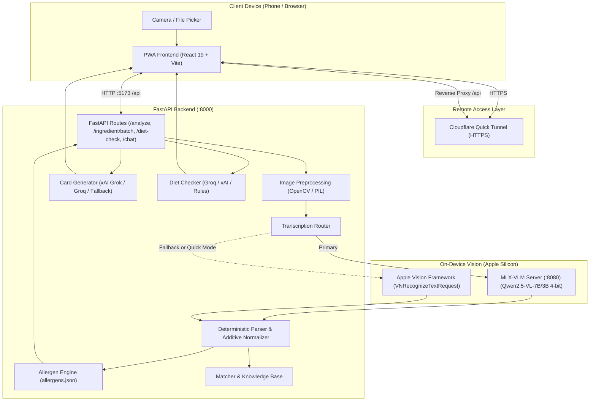

# Unwrap 

> **Understand what you eat.** Instant allergen alerts, deterministic ingredient parsing, and visual AI ingredient explainer cards powered by on-device vision models and Apple Silicon acceleration.

[](https://www.python.org/)
[](https://fastapi.tiangolo.com/)
[](https://react.dev/)
[](https://www.typescriptlang.org/)
[](https://tailwindcss.com/)
[](https://github.com/ml-explore/mlx)
[](https://docs.pytest.org/)

---

## Table of Contents

- [Overview](#overview)
- [Architecture & Key Features](#architecture--key-features)
- [System Architecture Diagram](#system-architecture-diagram)
- [Hardware & Software Prerequisites](#hardware--software-prerequisites)
- [Step-by-Step Installation](#step-by-step-installation)
  - [1. Clone Repository](#1-clone-repository)
  - [2. Backend Setup (Python)](#2-backend-setup-python)
  - [3. Environment Configuration](#3-environment-configuration)
  - [4. Frontend Setup (React / Vite)](#4-frontend-setup-react--vite)
- [Running the Application](#running-the-application)
  - [Option A: Standard Development Mode (FastAPI + Vite)](#option-a-standard-development-mode-fastapi--vite)
  - [Option B: Running the Local MLX-VLM Server (Apple Silicon)](#option-b-running-the-local-mlx-vlm-server-apple-silicon)
  - [Option C: Testing on Mobile via Cloudflare Tunnel](#option-c-testing-on-mobile-via-cloudflare-tunnel)
- [API Reference](#api-reference)
- [Testing & Verification](#testing--verification)
- [Benchmarking Suite](#benchmarking-suite)
- [Configuration Reference (`.env`)](#configuration-reference-env)
- [Repository Structure](#repository-structure)
- [Troubleshooting & FAQ](#troubleshooting--faq)

---

## Overview

**Unwrap** is an open-source, mobile-first food transparency application and benchmarking platform. When you snap a photo of a packaged food label:
1. **Ultra-Fast Local Transcription**: Runs either on-device native Apple Vision OCR (<250 ms) or an MLX 4-bit Vision-Language Model (`Qwen2.5-VL-7B` / `3B`) with automatic fallback.
2. **Deterministic Safety Checking**: Employs rigorous regex parsing, INS / E-number normalization (e.g. converting `476` into `INS 476`), and hierarchical allergen evaluation across 10+ major allergens to prevent dangerous `FALSE_CLEAR` classifications.
3. **Visual Ingredient Cards**: Generates clear, functional cards with role-based colors, origins (plant, synthetic, animal, mineral), and step-by-step illustrations of how each ingredient is processed.
4. **AI Dietary Compliance Check**: Evaluates compatibility with Vegan, Vegetarian (strict or ovo-lacto), Jain, and Halal diets, providing actionable justifications without false "safe" claims.
5. **Card-Grounded Bounded Chat**: Allows asking free-text questions grounded strictly in the verified ingredient card data, immune to prompt injections.

---

## Architecture & Key Features

- **Dual-Engine Vision Pipeline**:
  - **Native Apple Vision OCR**: Uses macOS `VNRecognizeTextRequest` on the Apple Neural Engine. Fast (<250 ms), uses <50 MB RAM.
  - **Local MLX-VLM**: Runs quantized 4-bit vision-language models (`mlx-community/Qwen2.5-VL-7B-Instruct-4bit` or `3B`) via an OpenAI-compatible continuous-batching server on Apple Silicon GPU unified memory.
  - **Graceful Fallback**: If the VLM server is offline or times out, the system automatically falls back to Apple Vision OCR in <120 ms.
- **Deterministic Additive & Allergen Engine**:
  - Automatically identifies and canonicalizes additive codes (`INS 322`, `E476`, `500(ii)`, `516`, etc.).
  - Evaluates derived allergen codes (e.g. `INS 322` or `INS 476` yielding `MIGHT_CONTAIN` for soy profile).
  - Cross-checks allergens across `Contains:` statements, `May Contain:` precautionary warnings, and individual ingredients.
- **Card-Grounded Chat & Injection Protection**:
  - User questions are capped at 300 characters.
  - User text and card text are strictly treated as passive data, disallowing prompt injections (e.g. "Ignore previous instructions", "Override system").
  - Disallows medical or safety advice.
- **Mobile PWA**:
  - Built with React 19, TypeScript, Tailwind CSS, and Framer Motion.
  - Full PWA support (installable directly to your home screen on iOS and Android).
  - Built-in camera capture, gallery upload, swipeable cards, and interactive search.
- **Cloudflare Tunnel Integration**:
  - Single-command HTTPS tunnel (`./scripts/tunnel.sh`) allowing immediate testing with physical smartphone cameras without complex network or certificate setups.
  - Automatic `/api` reverse proxying through Vite to bypass browser Mixed Content (HTTPS -> HTTP) and CORS restrictions.

---

## System Architecture Diagram



---

## Hardware & Software Prerequisites

- **Operating System**:
  - **macOS** (Apple Silicon M1/M2/M3/M4/M5 recommended for on-device MLX-VLM and native Apple Vision OCR).
  - *Linux / Windows*: Supported for backend API and frontend PWA (Apple Vision OCR falls back to standard OCR or remote VLM).
- **Python**: 3.10, 3.11, 3.12, 3.13, or 3.14.
- **Node.js**: v18.0.0 or later (with `npm`).
- **RAM**: Minimum 8 GB (16 GB unified RAM recommended if running local 7B VLM).
- **Optional Tools**:
  - `cloudflared` (for phone camera testing over HTTPS).
  - `git`.

---

## Step-by-Step Installation

### 1. Clone Repository

```bash
git clone https://github.com/your-username/WillItKillMe.git
cd WillItKillMe
```

### 2. Backend Setup (Python)

Create and activate a virtual environment:

```bash
# Create virtual environment
python3 -m venv .venv

# Activate virtual environment
# macOS / Linux:
source .venv/bin/activate
# Windows:
# .venv\Scripts\activate
```

Install core Python dependencies:

```bash
pip install --upgrade pip
pip install -r requirements.txt
```

*(macOS Apple Silicon Only)* Install Apple Vision PyObjC bindings and local MLX vision framework:

```bash
pip install pyobjc-framework-Vision pyobjc-framework-Cocoa mlx mlx-vlm
```

### 3. Environment Configuration

Copy the example configuration to `.env`:

```bash
cp .env.example .env
```

Open `.env` in your editor and configure your preferred backends:

```bash
# VLM (Vision-Language Model) backend: "local" or "remote"
VLM_BACKEND=local
VLM_BASE_URL=http://localhost:8080/v1
VLM_MODEL_NAME=mlx-community/Qwen2.5-VL-7B-Instruct-4bit

# AI Cards & Chat generation backend: "xai", "groq", "gemini", or "local"
CHAT_BACKEND=xai
XAI_API_KEY=your_xai_api_key_here
XAI_MODEL=grok-2-latest

# Optional fallback keys:
GROQ_API_KEY=your_groq_api_key_here
GEMINI_API_KEY=your_gemini_api_key_here
```

> **Note**: Even without external API keys, the core OCR, parsing, additive normalization, allergen engine, and mock fallbacks run 100% locally and pass all tests.

### 4. Frontend Setup (React / Vite)

In a separate terminal or subshell:

```bash
cd frontend
npm install
cd ..
```

---

## Running the Application

### Option A: Standard Development Mode (FastAPI + Vite)

**Terminal 1 — Backend API Server (Port 8000):**
```bash
source .venv/bin/activate
uvicorn backend.main:app --host 0.0.0.0 --port 8000 --reload
```

**Terminal 2 — Frontend Dev Server (Port 5173):**
```bash
cd frontend
npm run dev
```

Open your browser at **[http://localhost:5173](http://localhost:5173)**.  
The Vite server automatically proxies requests starting with `/api` directly to `http://127.0.0.1:8000`.

---

### Option B: Running the Local MLX-VLM Server (Apple Silicon)

If you have an Apple Silicon Mac and want on-device 4-bit vision model inference:

```bash
source .venv/bin/activate

# Launch continuous batching OpenAI-compatible MLX server:
python3 -m mlx_vlm.server \
  --model mlx-community/Qwen2.5-VL-7B-Instruct-4bit \
  --port 8080 \
  --host 127.0.0.1
```

*(For Macs with tighter memory constraints, use the 3B model)*:
```bash
python3 -m mlx_vlm.server \
  --model mlx-community/Qwen2.5-VL-3B-Instruct-4bit \
  --port 8080
```

> [!TIP]
> You can leave the MLX server off whenever you prefer ultra-fast transcription. When the MLX server is offline, Unwrap seamlessly and automatically routes all image processing to the native Apple Vision Neural Engine in <250 ms.

---

### Option C: Testing on Mobile via Cloudflare Tunnel

To test camera scanning from your actual smartphone (iOS Safari or Android Chrome) with a valid HTTPS certificate:

Ensure both the backend (Port 8000) and frontend (Port 5173) are running, then run:

```bash
./scripts/tunnel.sh
```

*(Or run directly)*:
```bash
cloudflared tunnel --url http://127.0.0.1:5173
```

Cloudflare will generate a public HTTPS URL (e.g., `https://random-name.trycloudflare.com`).  
1. Open this link on your smartphone.
2. Allow camera access.
3. Tap **"Add to Home Screen"** to experience Unwrap as a native fullscreen PWA!

---

## API Reference

The backend provides a clean RESTful API:

| Method | Endpoint | Description |
| :--- | :--- | :--- |
| `POST` | `/analyze` | Multi-part form upload with image file & JSON profile. Runs vision transcription, additive normalization, and allergen evaluation. |
| `POST` | `/reanalyze` | Fast re-evaluation of edited ingredient text and updated allergen profile without re-running vision. |
| `POST` | `/ingredient/batch` | Batch fetch/generate AI ingredient cards (role, one-liner, origin, how-it's-made steps). |
| `GET` | `/ingredient/{id}` | Retrieve individual ingredient card by normalized name or ID. |
| `POST` | `/diet-check` | Evaluate ingredients against dietary preferences (Vegan, Vegetarian, Jain, Halal). |
| `POST` | `/chat` | Card-grounded Q&A bounded strictly to ingredient card facts (max 300 char input). |
| `GET` | `/health` | Live system health check pinging MLX-VLM server, Apple Vision, and Knowledge Base. |

Interactive OpenAPI documentation is available locally at:
👉 **[http://localhost:8000/docs](http://localhost:8000/docs)**

---

## Testing & Verification

### Running the Pytest Suite

Run all unit, integration, and security tests:

```bash
source .venv/bin/activate
pytest -v
```

Expected result:
```text
============================= 162 passed in ~5.7s =============================
```

### Running the End-to-End Vision Smoke Test

Generates a synthetic food package label and tests both Apple Vision and VLM fallback paths:

```bash
source .venv/bin/activate
python scripts/smoke_test.py
```

---

## Benchmarking Suite

The repository includes a scientific benchmarking harness in `/benchmark` that runs on-device without cloud models. It evaluates transcription accuracy and safety across 4 engines on real packaging images:
- `apple_vision_raw` (Native Vision OCR without correction)
- `apple_vision_corrected` (Native Vision OCR with deterministic spelling correction)
- `vlm_qwen25vl_7b` (`mlx-community/Qwen2.5-VL-7B-Instruct-4bit`)
- `vlm_qwen3vl_8b` (4-bit MLX model with automatic 3B fallback)

### Running the Benchmark

```bash
source .venv/bin/activate

# Complete benchmark with all ablations (resolutions 1024/1280/1536 & preprocessing on/off):
python -m benchmark.run

# Quick run (default configurations only, skipping ablations):
python -m benchmark.run --no-ablations

# Evaluate specific engines only:
python -m benchmark.run --engines apple_vision_raw apple_vision_corrected
```

### Generated Artifacts in `benchmark/results/`

- `summary.csv`: Aggregated CER, WER, Ingredient F1, Allergen Accuracy, False Clears, Latency (Mean/P50/P95), and Bootstrap 95% Confidence Intervals.
- `breakdown_by_tag.csv`: Performance segmented by packaging difficulty (dense additives, curved pouches, real photos, etc.).
- `accuracy_vs_latency.png`: Scatter plot comparing transcription quality against inference speed.
- `latency_boxplots.png`: Statistical distribution of execution latency per engine.
- `peak_memory_barchart.png`: Peak process RSS and Apple Silicon GPU unified memory usage.
- `report.md`: Complete executive summary report.
- `failures/`: Word-level markdown diffs for worst-case failure analyses.

---

## Configuration Reference (`.env`)

| Variable | Default | Description |
| :--- | :--- | :--- |
| `VLM_BACKEND` | `local` | Vision engine mode (`local` for MLX server or `remote`). |
| `VLM_BASE_URL` | `http://localhost:8080/v1` | URL of the local MLX-VLM server. |
| `VLM_MODEL_NAME` | `mlx-community/Qwen2.5-VL-7B-Instruct-4bit` | HuggingFace repo ID for the local VLM. |
| `VLM_TIMEOUT_SECONDS` | `60` | Network timeout for VLM inference calls. |
| `CHAT_BACKEND` | `xai` | Provider for ingredient cards and chat (`xai`, `groq`, `gemini`, `local`). |
| `XAI_API_KEY` | *(empty)* | API key for xAI Grok. |
| `XAI_MODEL` | `grok-2-latest` | Model identifier for xAI. |
| `GROQ_API_KEY` | *(empty)* | Optional API key for Groq fallback. |
| `GEMINI_API_KEY` | *(empty)* | Optional API key for Google Gemini fallback. |
| `FUZZY_MATCH_THRESHOLD` | `92` | RapidFuzz similarity threshold (0–100) for ingredient matching. |
| `DEBUG_MODE` | `False` | Verbose debug output and timing diagnostics. |

---

## Repository Structure

```text
WillItKillMe/
├── backend/
│   ├── ai_cards.py             # Generates role, one-liner, origin & how-made steps
│   ├── allergen_engine.py      # Deterministic allergen hierarchy & warning checker
│   ├── chat.py                 # Grounded Q&A module with prompt-injection defense
│   ├── config.py               # Pydantic Settings configuration
│   ├── data/
│   │   ├── allergens.json      # Allergen taxonomy & ingredient mappings
│   │   └── ingredients.json    # Seed dictionary for common ingredients
│   ├── diet_check.py           # Dietary conflict analyzer (Vegan/Veg/Jain/Halal)
│   ├── image_processing.py     # Resizing, normalization & format conversions
│   ├── main.py                 # FastAPI application routes & lifecycle
│   ├── matcher.py              # Exact, additive code & fuzzy string matcher
│   ├── models.py               # Pydantic data schemas
│   ├── ocr.py                  # macOS Apple Vision PyObjC interface
│   ├── parser.py               # Additive normalization (INS/E-numbers) & parser
│   ├── tests/                  # Pytest test suite (162 tests)
│   ├── transcription.py        # Vision engine router & fallback coordinator
│   └── vlm.py                  # MLX-VLM client & prompt templates
├── benchmark/
│   ├── engines/                # Benchmark engine wrappers (Apple Vision, VLM)
│   ├── metrics/                # CER, WER, F1, FLOPs & Allergen accuracy metrics
│   ├── photos/                 # Real packaging benchmark images
│   ├── results/                # Visual plots, error tables, CSVs & report.md
│   ├── ground_truth.json       # Ground-truth transcriptions and allergen labels
│   ├── run.py                  # CLI benchmark runner
│   ├── runner.py               # Resumable test protocol execution engine
│   └── visualize.py            # Matplotlib / Seaborn chart generator
├── frontend/
│   ├── src/
│   │   ├── components/         # Card deck, Allergen banner, Diet banner, Chat modal
│   │   ├── api.ts              # Fetch client with dynamic tunnel URL detection
│   │   ├── types.ts            # TypeScript interfaces matching backend models
│   │   ├── App.tsx             # Main application orchestrator
│   │   └── main.tsx            # PWA registration and React root
│   ├── package.json            # Vite, React 19, Tailwind dependencies
│   └── vite.config.ts          # Reverse proxy and PWA configuration
├── scripts/
│   ├── setup_models.sh         # Helper to check Apple Vision & download models
│   ├── serve_vlm.py            # Local MLX VLM launcher helper
│   ├── smoke_test.py           # End-to-end vision pipeline sanity test
│   └── tunnel.sh               # Cloudflare HTTPS tunnel script for phone testing
├── .env.example                # Example environment variable template
├── requirements.txt            # Python dependencies
└── README.md                   # Project documentation
```

---

## Troubleshooting & FAQ

### 1. What does `marked unknown (no KB match)` in the logs mean?
This is an informational notice, **not** an error. `backend/data/ingredients.json` contains a small seed dictionary of 69 common staples (sugar, wheat flour, salt, etc.). Real food packages have thousands of distinct ingredients. When an unlisted ingredient (e.g. *Milk Solids*, *Cocoa Mass*, *INS 476*) appears, the system logs `unknown (no KB match)`. The dedicated allergen engine directly catches the allergen via its taxonomy, and the AI card engine generates the visual card on demand.

### 2. Why does the phone say "Failed to fetch" when uploading a photo?
This occurs if the mobile browser attempts to connect to `http://localhost:8000` from an external device. Unwrap solves this automatically:
- When using the Cloudflare tunnel (`./scripts/tunnel.sh`), the frontend automatically routes all API requests via `/api`, which Vite securely forwards to the backend at `http://127.0.0.1:8000`.
- Ensure both `npm run dev` and `uvicorn` are running before launching the tunnel.

### 3. How does memory management work on 16 GB Apple Silicon Macs?
Unwrap adheres to a strict single-model memory rule. The Apple Vision OCR engine runs on the Neural Engine and consumes negligible memory (~50 MB). When running a 4-bit MLX model (`Qwen2.5-VL-7B`), the server reserves ~5.5–6.2 GB of unified RAM, safely leaving plenty of headroom for macOS and other applications.

---

## License

This project is licensed under the [MIT License](LICENSE).
